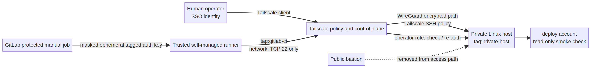

# Bastionless DevSecOps: GitLab CI + Tailscale SSH

A portfolio project showing how a DevSecOps team can remove a publicly reachable bastion from its access path. GitLab CI joins a private Tailscale network as an ephemeral, tagged node, then runs a read-only smoke check against a private Linux host using Tailscale SSH. Human operators use their identity and the same least-privilege network policy.

> **Demo, not production deployment:** This repository contains configuration examples and tests. It does not create a Tailscale tailnet, GitLab runner, cloud VM, or change firewall rules. You must configure those in your own environment before running the protected manual job.



## Why this project

Traditional bastions centralize SSH access but also add a publicly reachable entry point, patching work, key management, and a high-value host to monitor. This example moves authorization to identity-aware, device-to-device private access: no inbound public SSH rule is required, and CI receives only a narrow path to the `deploy` account on tagged private hosts.

## What it demonstrates

- GitLab CI pipeline validation and automated tests for access-policy guardrails.
- A protected, manual CI job that joins Tailscale with a tagged ephemeral auth key.
- Network access limited to TCP/22 from `tag:gitlab-ci` to `tag:private-host`.
- Tailscale SSH restricted to the existing non-root `deploy` account for CI.
- Human operator SSH access governed by a separate group and periodic re-authentication.
- A smoke check that verifies private connectivity and remote identity without changing the target.
- A staged migration approach: validate access before removing public bastion/SSH exposure.

## Architecture

See [the architecture and trust boundaries](docs/architecture.md) and the rendered [diagram](docs/architecture.png).

## Prerequisites

You need a GitLab project and a Linux GitLab Runner that you administer. The runner must have Tailscale CLI support and a working `/dev/net/tun` device with the required network capabilities. The included job expects a runner tagged `tailscale-tun`; do not run it on an untrusted shared runner.

You also need a Tailscale tailnet with Tailscale SSH enabled on a private Linux target, plus a local `deploy` account. Configure the policy from `tailscale-policy.hujson` by merging the relevant entries into your existing tailnet policy. Replace `ops@example.com` with the actual operator identity. Review the policy with your security/network owner before applying it.

## Setup

1. **Configure tailnet policy.** Create/assign `tag:gitlab-ci` to the CI auth key and `tag:private-host` to the Linux target. Merge the ACL, SSH, and tag-owner sections in `tailscale-policy.hujson` into your existing policy. Do not replace an existing policy file wholesale.
2. **Prepare the target.** Install Tailscale, enroll it with `tag:private-host`, create a restricted `deploy` account, then enable Tailscale SSH with `sudo tailscale set --ssh`. Confirm the host is reachable by its MagicDNS name from an authorized tailnet device.
3. **Prepare CI credentials.** Create a Tailscale auth key tagged as `tag:gitlab-ci`, reusable, ephemeral, and pre-approved if device approval is enabled. Store it in GitLab CI/CD variables as `TAILSCALE_AUTHKEY`, masked and protected. Keep it scoped to this project and rotate it according to your policy.
4. **Set target variables.** Add `PRIVATE_TARGET_HOST` (the target's Tailscale MagicDNS hostname) and `PRIVATE_TARGET_USER` (`deploy`) as protected GitLab variables. Avoid putting secrets or private IPs in the repository.
5. **Use a trusted runner.** Register a self-managed Linux runner with the `tailscale-tun` tag. Ensure the executor exposes TUN/network capability to the job. Keep it isolated from untrusted project workloads.
6. **Run the pipeline.** Push the repo to GitLab. Validation runs automatically. On the protected default branch, manually start `private_access_smoke`. It connects to the target and prints hostname and account identity only.
7. **Plan bastion retirement.** First confirm interactive operator access and break-glass access. Then remove public inbound SSH only after security review, monitoring, and rollback testing.

## Security boundaries and limitations

The GitLab integration uses the Tailscale-documented tagged, reusable, ephemeral auth-key pattern. Ephemeral nodes are cleaned up after the job, but the auth key itself is still a secret and must be protected and rotated. The OIDC token declaration has intentionally not been used as a substitute: configure workload identity federation only if your chosen Tailscale/GitLab integration explicitly supports and documents it for your environment.

This demonstration is not a full deployment pipeline. The remote command is read-only and proves access; adapt it to a narrowly scoped deployment command after adding approval gates, artifact integrity checks, audit logging, and rollback. The sample runner configuration, target provisioning, tailnet policy, firewall changes, and GitLab variables are intentionally not automated here.

For a production rollout, test failure modes such as tailnet control-plane unavailability, lost operator identity, runner compromise, auth-key revocation, and target recovery. Keep a documented out-of-band recovery path until the replacement is proven.

## Project contents

- `.gitlab-ci.yml` — validate policy and run protected manual access smoke check.
- `tailscale-policy.hujson` — example access policy with distinct human and CI paths.
- `scripts/private_access_smoke.sh` — safe remote identity check over Tailscale SSH.
- `scripts/validate_policy.py` and `tests/` — standard-library policy invariant tests.
- `docs/` — architecture, migration runbook, threat model, and LinkedIn showcase copy.

## Run checks locally

```bash
python3 scripts/validate_policy.py
python3 -m unittest discover -s tests -v
```

## Upstream references

- [Tailscale with GitLab CI/CD](https://tailscale.com/docs/integrations/gitlab/gitlab-runner)
- [Tailscale SSH](https://tailscale.com/docs/features/tailscale-ssh)
- [Tailscale policy syntax](https://tailscale.com/docs/reference/syntax/policy-file)
- [GitLab CI ID token authentication](https://docs.gitlab.com/ci/secrets/id_token_authentication/)
