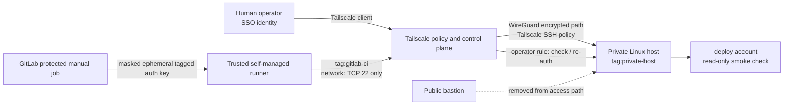

# Architecture and access flow

## Components

1. **GitLab project** runs validation and a protected manual CI access check.
2. **Self-managed GitLab Runner** executes the job on trusted infrastructure with TUN/network support. The runner must not process untrusted workloads.
3. **Tailscale control plane** enrolls the ephemeral CI node and enforces identity/tag-based network and SSH policy.
4. **Private Linux target** is tagged `tag:private-host`, advertises Tailscale SSH, and has a non-root `deploy` account.
5. **Human operators** connect with their own tailnet identity under a separate policy rule.

## Flow

1. GitLab starts the manual job only on the protected default branch.
2. The job reads the masked, protected `TAILSCALE_AUTHKEY` variable and joins the tailnet as an ephemeral `tag:gitlab-ci` node.
3. Tailnet policy permits that node to reach only SSH on `tag:private-host` devices.
4. Tailscale SSH policy permits CI to use only the target's local `deploy` account.
5. The smoke script pings the target and runs `hostname` and `id`; it does not modify the machine.
6. The job exits and the ephemeral runner node is removed by Tailscale. The auth key remains a secret and should be rotated/revoked as needed.

## Trust boundaries

- GitLab protected variables and protected refs form the CI credential boundary.
- The self-managed runner is trusted infrastructure and is a security-sensitive component.
- Tailnet ACLs and SSH rules are separate controls: network reachability alone does not grant SSH login.
- The target's local accounts and sudo rules remain host-level controls.
- Public SSH exposure is outside this repository's automation. Disable it only after validating access, monitoring, and recovery.

